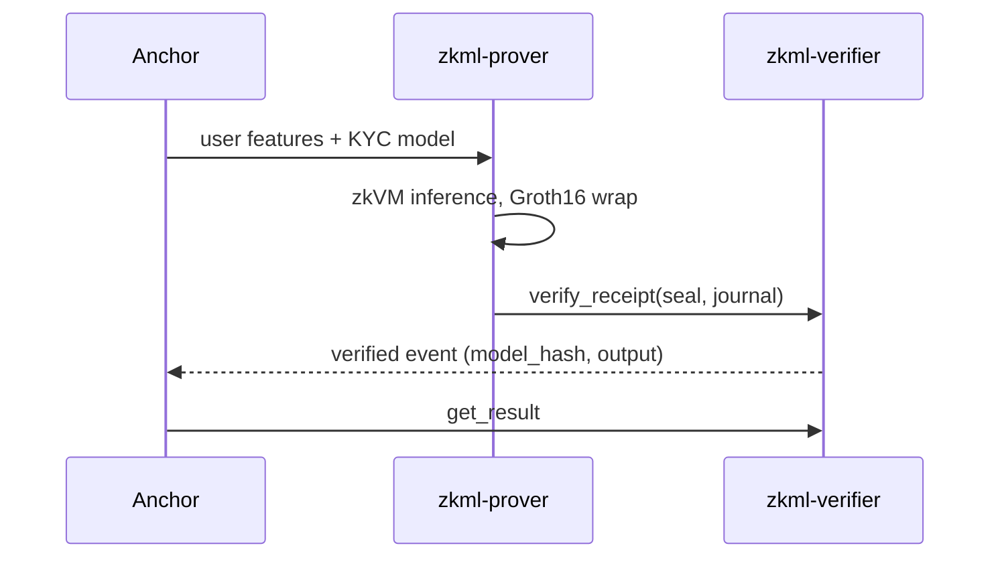

The KYC demo in `examples/kyc-demo/` is the Phase 1 target scenario: train a
decision tree on synthetic KYC data, register it on a testnet verifier, prove a
risk score, and verify it on-chain.

<Frame>
  
</Frame>

## Status

| Step                                    | Status                                              |
| --------------------------------------- | --------------------------------------------------- |
| Synthetic dataset (`generate_dataset.py`) | Works                                             |
| Training and ONNX export (`train_model.py`) | Works, exports with `target_opset=17`           |
| ONNX import into `zkml-prover`          | Works: a decision tree of 43 nodes over 10 features |
| Model commitment                        | Available via `zkml-prover commit` (JSON or ONNX)   |
| Contract build and deployment           | Works with the `stellar` CLI ([guide](/guides/deployment)) |
| On-chain receipt verification (`verify_receipt`) | Verified on testnet ([transactions](/guides/deployment#live-on-testnet)) |
| Groth16 proof generation                | Works on x86_64 Linux with Docker (`prove --groth16`) |
| RISC Zero parameter export              | Works (`export-vk --format soroban-args`)           |
| End-to-end script (`deploy.sh`)         | Works: the KYC tree verified on testnet on 2026-11-20 ([transactions](/guides/deployment#live-on-testnet)) |
| Demo runner (`zkml-demo`)               | Works: proves or takes `--bundle`, deploys, verifies and reports the success criteria |
| The trained ONNX model through the CLI  | Works: every subcommand takes `.onnx` files         |

## 1. Generate the dataset

```bash
cd examples/kyc-demo
pip install -r requirements.txt
python generate_dataset.py      # writes kyc_dataset.csv (1000 records)
```

Features: `age`, `account_age_days`, `transaction_count_30d`,
`avg_transaction_amount`, `has_verified_doc`, `jurisdiction_risk_score`,
`login_frequency_30d`, `device_trust_score`, `email_domain_age_days`,
`phone_verified`.

## 2. Train and export

```bash
python train_model.py           # writes kyc_decision_tree.onnx
```

The model is a `DecisionTreeClassifier` with `max_depth=5` and three risk tiers
(0 low, 1 medium, 2 high).

`train_model.py` exports with `target_opset=17`, which is the floor the
importer enforces for the core domain (`MIN_OPSET_CORE`). To check the file
before importing it, run:

```bash
python check_model.py
```

It prints every opset import and every operator in the graph, and exits with a
non-zero status when the core opset is too low. See also the tier mapping
limitation below.

## 3. Deploy, prove and verify

From the repository root, on x86_64 Linux with Docker and the stellar CLI:

```bash
examples/kyc-demo/deploy.sh
```

It creates and funds a testnet identity if needed, generates the model's
secret opening in `target/kyc-demo/model.opening`, deploys the verifier with
the KYC tree's hiding commitment, registers the reproducible guest, proves one risk
score with Groth16 (about 25 minutes of CPU) and records it with
`verify_receipt`, then reads the result back. The step-by-step commands are in
[Testnet deployment](/guides/deployment), which also lists the transactions
of the first verification on testnet.

The script proves `examples/models/kyc_tree.json`, the three-feature JSON tree,
on `0.6,0.4,0.0`, which takes the high-risk branch: `output` is `65536`, risk
`1.0` in Q16.16. `KYC_MODEL` and `KYC_INPUT` change both; the ONNX model from
step 2 needs converting to the JSON format first, since the CLI does not read
ONNX.



## 4. Run the demo runner

```bash
# Prove here (x86_64 Linux with Docker), deploy a fresh verifier, verify, report:
cargo run --release -p zkml-demo --features groth16,zkvm --   --model examples/kyc-demo/kyc_decision_tree.onnx -i "<10 features>"   --opening target/kyc-demo/model.opening --source zkml-demo --report report.json

# Anywhere else: submit a bundle proved on Linux, with the RISC Zero
# parameters exported next to it:
cargo run -p zkml-demo -- --model examples/models/kyc_tree.json -i "0.6,0.4,0.0"   --opening model.opening --bundle bundle.json --risc0-params risc0.json
```

The runner checks the bundle against the native run before submitting it: the
model commitment under the opening, the output and the class must match. Then
it deploys the verifier with the `stellar` CLI (unless `--contract` names one),
registers the bundle's guest, submits `verify_receipt`, reads `get_result` back
and prints a report: stage timings, seal and journal sizes, the fee charged and
each Phase 1 criterion (proof under 500 bytes, end to end under 60 s, the
on-chain result equal to the native prediction) marked pass, fail or not
measured. `--report` also writes it as JSON. Local proving takes about half an
hour, so the latency criterion fails until remote proving lands; with
`--bundle` it is not measured.

## Mapping risk tiers to the public inputs

For decision trees, `class_label` is the tier and `output` carries the leaf value
(raw Q16.16): for a JSON tree whose leaves store the tier, `class_label` is `2`
for tier 2 and `output` is `2 * 65536`. Up to `0.0.5` trees reported
`class_label` `0`, and the tier was only in `output`. A multi-class ONNX `TreeEnsembleClassifier`, such as the model
from step 2, imports with the predicted class in each leaf, so its output is the
tier too; see [ONNX import](/guides/onnx-import#tree-leaf-values).

## Success criteria

- Proof size under 500 bytes (a Groth16 proof is 256 bytes in the contract encoding)
- End-to-end latency under 60 seconds
- Verified risk tier readable on-chain
